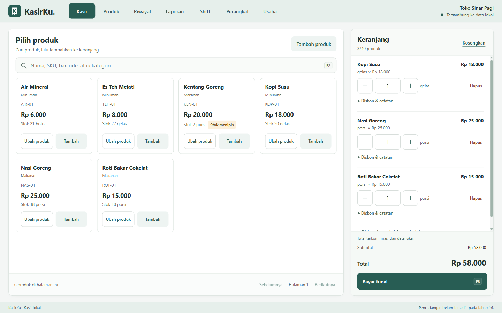
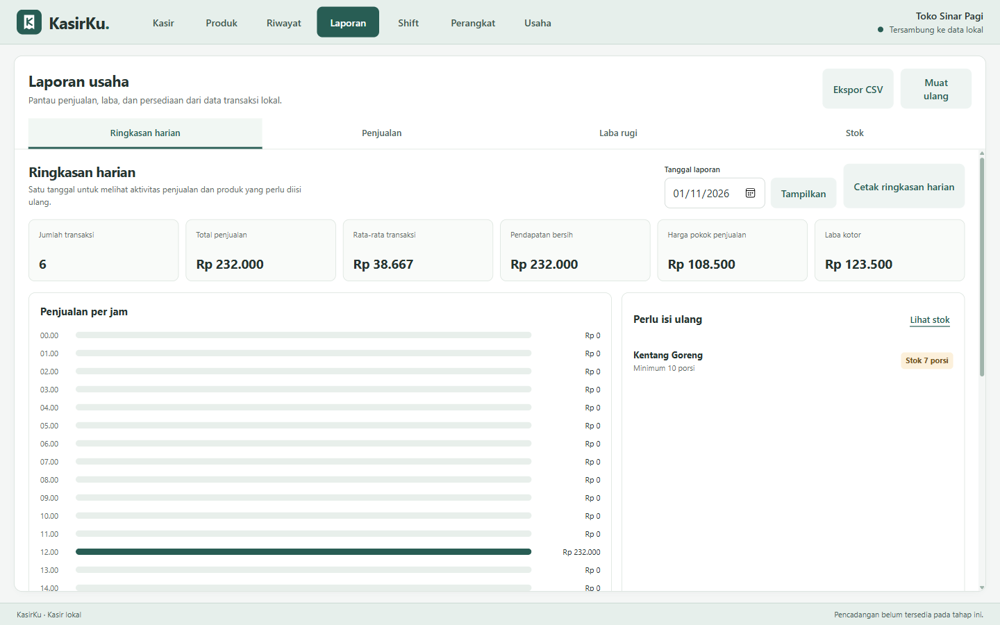
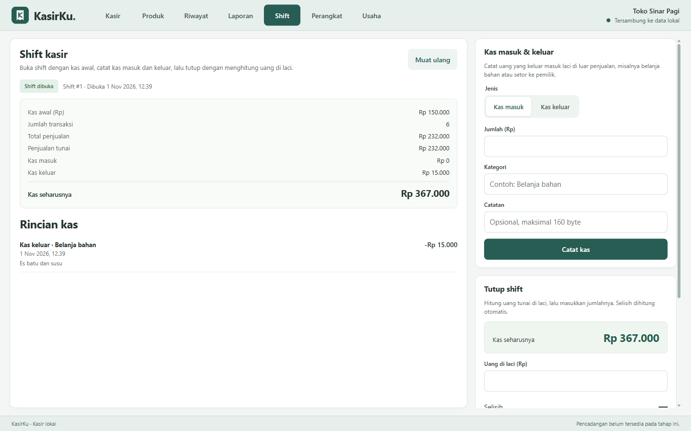
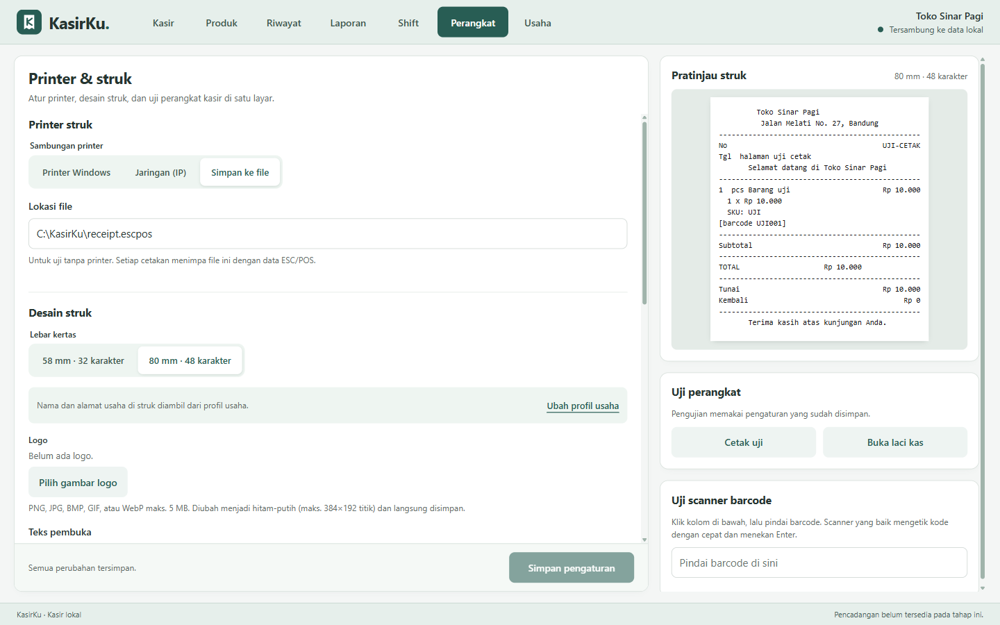

<p align="center">
  
</p>

<h1 align="center">KasirKu</h1>

<p align="center">
  <strong>Offline-first point of sale for Indonesian small businesses.</strong><br>
  A native Windows desktop application for dependable sales, cash control, receipts, and local business reporting.
</p>

<p align="center">
  <strong>English</strong> · <a href="README.id.md">Bahasa Indonesia</a>
</p>

---

**Version:** 0.1.0 · **Platform:** Windows x64 · **Storage:** Local SQLite · **Runtime internet:** Not required

> **Project status:** Active development. The core cashier workflow is implemented and covered by automated tests. KasirKu is not yet presented as a feature-complete business suite or a turnkey production release; see [Current boundaries](#current-boundaries) and [Engineering roadmap](#engineering-roadmap).

## Application preview



<p align="center">
  <sub>The cashier workspace keeps product discovery, cart editing, confirmed totals, and payment in one focused view.</sub>
</p>

| Local business reports | Cashier shift control | Printer and receipt setup |
| --- | --- | --- |
|  |  |  |
| <sub>Daily metrics, hourly sales, and replenishment alerts.</sub> | <sub>Opening cash, cash movements, and the expected drawer balance.</sub> | <sub>58/80 mm receipts, ESC/POS backends, and a live preview.</sub> |

<p align="center">
  <sub>Screenshots captured from the real KasirKu desktop application using an isolated profile and fictional demo data.</sub>
</p>

## Why KasirKu

A point-of-sale system handles money, inventory, and business records. Those responsibilities require more than a polished checkout screen.

KasirKu is built around a simple premise: **a sale must remain correct when connectivity disappears, a product changes during checkout, a request is retried, a printer fails, or the application is upgraded.** The project therefore invests in transaction boundaries, immutable sales snapshots, deterministic money calculations, explicit recovery states, and native integration—not only in the interface.

The application is designed for Indonesian MSMEs that need a practical counter tool without making daily operations dependent on a server, subscription, or internet connection.

## Contents

- [Application preview](#application-preview)
- [Product capabilities](#product-capabilities)
- [A typical working day](#a-typical-working-day)
- [Architecture](#architecture)
- [Engineering decisions](#engineering-decisions)
- [Technology stack](#technology-stack)
- [Getting started](#getting-started)
- [Build and run](#build-and-run)
- [Verification and testing](#verification-and-testing)
- [Local data and durability](#local-data-and-durability)
- [CSV interchange](#csv-interchange)
- [Reporting definitions](#reporting-definitions)
- [Security and privacy](#security-and-privacy)
- [Current boundaries](#current-boundaries)
- [Engineering roadmap](#engineering-roadmap)
- [Project structure](#project-structure)
- [Contributing](#contributing)
- [License](#license)

## Product capabilities

| Area | Implemented capabilities |
| --- | --- |
| **Business setup** | Local business profile with name, address, and retail, food, or service mode. |
| **Product catalog** | Create, edit, search, paginate, and archive products; SKU, barcode, category, unit, price, cost, stock, and minimum stock; tracked inventory or untracked services. |
| **Cashier** | Searchable catalog, keyboard-compatible barcode scanning, fractional quantities, item notes, line and transaction discounts, cash rounding, stock validation, and a server-quoted cart. |
| **Cash payment** | Tendered amount, quick nominal choices, exact-payment option, change calculation, underpayment rejection, and retry-safe checkout. |
| **Sales history** | Paginated local history and detailed receipts based on the names, prices, costs, discounts, and business identity captured when the sale occurred. |
| **Shift control** | One open shift at a time, opening cash, idempotent cash-in/cash-out entries, expected cash, counted cash, variance, closing notes, and shift reports. Every sale belongs to an open shift. |
| **Thermal printing** | ESC/POS receipts and reports on 58 mm or 80 mm paper; Windows RAW spooler, file output, or TCP port 9100; configurable copies, feed, cut, and cash-drawer pulse. |
| **Receipt design** | Live text preview, monochrome logo, header, footer, optional SKU, barcode, and QR payload. Reprints are explicitly marked as copies. |
| **Reports** | Daily dashboard, hourly sales, top products, low-stock alerts, sales by day/product/category, profit and expense categories, stock value, low stock, and dead stock. |
| **Data interchange** | Native-save-dialog CSV export for products and complete report datasets; create-only product CSV import with preview, full-file validation, and atomic apply. |
| **Daily closeout** | Thermal daily summary with transaction counts, sales, average sale, revenue, COGS, gross profit, expenses, net profit, top products, and stock warnings. |

## A typical working day

1. **Configure the business once.** Set the local profile and, if needed, the printer and receipt layout.
2. **Prepare the catalog.** Enter products manually or import a validated CSV file.
3. **Open a shift.** Record the actual opening cash before accepting payment.
4. **Sell and print.** Build the cart, confirm the current quote, accept cash, and handle printing outcomes without duplicating the sale.
5. **Reconcile the drawer.** Record cash movements, close the shift, compare expected and counted cash, and print the shift report.
6. **Review the business.** Inspect dashboard, sales, profit, and stock reports; export the underlying data or print a daily summary.

## Architecture

KasirKu combines a small native core with a maintainable local web interface. It does not require Electron, a separate application server, or a JavaScript package-install step.

```text
┌───────────────────────────────────────────────────────────┐
                    Native Windows process

  ┌──────────────────────┐          ┌──────────────────────┐
  │ HTML / CSS / JS UI   │          │ Zig application core │
  │ WebView2 frontend    │  JSON    │ POS, shifts, reports │
  │ presentation + state ├─────────▶│ validation + workflow│
  └──────────────────────┘ messages └───────────┬──────────┘
             ▲                                  │
             │                 ┌────────────────┼──────────────┐
             │                 │                │              │
             │          ┌──────▼──────┐  ┌──────▼──────┐ ┌─────▼──────┐
             │          │ SQLite      │  │ ESC/POS     │ │ Native     │
             │          │ WAL + FULL  │  │ printer I/O │ │ file dialog│
             │          └─────────────┘  └─────────────┘ └────────────┘
             │
  ┌──────────┴──────────┐
  │ C++17 WebView2 host │
  │ UI STA + one worker │
  └─────────────────────┘
```

The interface runs in WebView2, but authoritative business decisions remain in the Zig core. The browser does not decide final totals, stock mutations, checkout uniqueness, shift reconciliation, or report values.

### Repository layers

- **`src/domain/`** — deterministic money, cart, inventory, and receipt rules.
- **`src/app/`** — product, checkout, shift, report, device, and CSV use cases.
- **`src/infra/db/`** — SQLite access, constraints, schema migrations, and migration recovery copies.
- **`src/infra/printer.zig`** — spooler, file, and network printer backends.
- **`src/infra/webview/host.cpp`** — native window, WebView2 lifecycle, message queue, worker thread, and native save dialog.
- **`src/bridge/`** — typed JSON command dispatch and stable error envelopes.
- **`ui/`** — dependency-free HTML, CSS, and JavaScript presentation layer.

## Engineering decisions

### Correct money and quantity arithmetic

- Rupiah values are stored and calculated as integers, not floating-point currency.
- Quantities use integer thousandths (`quantity_milli`), supporting fractional retail quantities without binary floating-point drift.
- Domain arithmetic validates underflow, overflow, discount bounds, quantities, and rounding increments.
- Values crossing the JSON bridge stay within JavaScript-safe integer bounds.

### Transactional and retry-safe sales

- Checkout re-quotes active products inside the write transaction rather than trusting browser totals.
- A unique `checkout_id` and input hash make a retry return the original result or reject a conflicting payload—not create a second sale.
- Sale, items, payment, stock mutation, and stock movement are committed together.
- Product revisions detect stale carts and conflicting edits.
- A sale stores business and item snapshots, so later product or profile edits do not rewrite history.
- The UI distinguishes a definite rejection from an unknown outcome and preserves the same attempt when recovery requires a retry.

### Durable local storage

- SQLite `STRICT` tables and foreign keys enforce important invariants at the storage boundary.
- WAL journaling, `synchronous=FULL`, and a busy timeout are configured explicitly.
- Versioned migrations run transactionally and validate migration history.
- Before an existing schema is upgraded, the application creates a recovery copy with the SQLite backup API.
- A newer, unrecognized, or inconsistent schema is refused rather than silently overwritten.

### A narrow native boundary

- Commands use strict `{id, command, payload}` envelopes with a 64 KiB request/response limit.
- Payload fields and scalar types are validated; arbitrary SQL execution is not exposed.
- One native worker serializes database and device work instead of allowing uncontrolled concurrent access from the UI.
- Native file output avoids browser-download limitations for potentially large CSV exports.
- Printer completion is reported honestly: submission success, definite failure, and uncertain physical output are different states.

### Testable receipts and portable data

- Receipt layout and ESC/POS bytes have golden references under `testdata/receipt/`.
- CSV output includes UTF-8 BOM, CRLF records, quoting, and embedded-newline support.
- Spreadsheet formula injection is mitigated for exported text beginning with `=`, `+`, `-`, or `@`.
- Report export reads the complete dataset in a consistent read transaction, not only the rows visible on screen.

## Technology stack

| Component | Choice | Reason |
| --- | --- | --- |
| Desktop target | Windows x64 | Matches the initial counter-hardware and Windows-printer target. |
| Core language | Zig 0.15.2 | Small native deployment, explicit control, and direct C interoperability. |
| Native host | C++17 + Win32 | WebView2 ownership, windowing, worker queue, and native file dialogs. |
| UI runtime | Microsoft Edge WebView2 SDK 1.0.3537.50 | Familiar web UI technology inside a native offline shell. |
| Frontend | HTML, CSS, vanilla JavaScript modules | No frontend framework or runtime package dependency. |
| Database | SQLite 3.54.1 amalgamation | Local transactional storage with a small operational footprint. |
| Printer protocol | ESC/POS | Direct support for common thermal-printer capabilities. |
| Test tooling | Zig tests + Node.js scripts + Chrome DevTools Protocol | Domain, bridge, UI, and real desktop integration coverage. |

Dependency versions are pinned by `tools/setup.ps1`, and downloaded archives are checked against expected SHA-256 hashes.

## Getting started

### Requirements

- Windows x64.
- Microsoft Edge WebView2 Evergreen Runtime.
- PowerShell for dependency setup and the Zig wrapper.
- Internet access **only for the initial dependency setup** or when refreshing dependencies.
- Node.js 24 or newer is recommended for the complete JavaScript and desktop test suites. The desktop suite uses Node's built-in `node:sqlite` module.
- Chrome or Edge for the browser-based UI suite.

No `npm install`, database server, or cloud account is required.

### Install development dependencies

From the repository root in PowerShell:

```powershell
.\tools\setup.ps1
```

The script prepares:

- the pinned Zig toolchain in `.tools/zig/`;
- the SQLite amalgamation in `vendor/sqlite/`;
- WebView2 headers, loader, and notices in `vendor/webview2/`.

These generated tool and vendor directories are intentionally excluded from version control.

## Build and run

```powershell
# Compile the application and its runtime assets
.\tools\zig.ps1 build

# Build and launch KasirKu
.\tools\zig.ps1 build run
```

The executable is written to:

```text
zig-out/bin/KasirKu.exe
```

The build output also includes `WebView2Loader.dll`, the local `ui/` assets, and third-party license notices. Keep these files together when copying a build to another directory or workstation.

On first launch, complete the business profile. Before accepting a sale, open a cashier shift. Printer setup is optional; sales can still be recorded without a configured printer.

### UI-only development preview

```powershell
node tools/preview.mjs
```

Open `http://127.0.0.1:4173`. This server is only a presentation preview: **it has no native bridge or database connection** and is not a substitute for the desktop application.

## Verification and testing

Run checks from the repository root.

### Domain, database, bridge, CSV, and receipt tests

```powershell
.\tools\zig.ps1 build test
```

This suite exercises arithmetic boundaries, transactional behavior, migrations, checkout idempotency, inventory, shifts, reports, bridge validation, CSV atomicity, printer formatting, and golden ESC/POS bytes.

### Native WebView2 smoke test

```powershell
.\tools\zig.ps1 build smoke
```

This starts the real native host with an isolated temporary profile and verifies a WebView2 → Zig → SQLite round trip.

### Browser UI regression suite

```powershell
node tools/test-ui.mjs
```

The suite uses a mocked native bridge and Edge by default. To select Chrome explicitly:

```powershell
$env:KASIRKU_BROWSER = 'C:\Program Files\Google\Chrome\Application\chrome.exe'
node tools/test-ui.mjs
```

It covers setup, catalog and import workflows, checkout recovery, printing states, shifts, reports, CSV export, responsive desktop layouts, and escaped text. Financial totals in this suite are mocks; the native suites verify actual calculations and persistence.

### Real desktop integration suite

```powershell
.\tools\zig.ps1 build
node tools/test-desktop.mjs
```

This launches the real WebView2/Zig/SQLite application with isolated data under `.cache/`, drives it through the Chrome DevTools Protocol, and verifies restart persistence. It closes its own test window when finished.

To test another already-built executable:

```powershell
$env:KASIRKU_EXE = 'C:\path\to\KasirKu.exe'
node tools/test-desktop.mjs
```

### JavaScript syntax checks

```powershell
Get-ChildItem ui\*.js, tools\*.mjs | ForEach-Object {
  node --check $_.FullName
  if ($LASTEXITCODE -ne 0) { exit $LASTEXITCODE }
}
```

### Regenerate receipt golden files

Only regenerate references when an ESC/POS change is intentional:

```powershell
.\tools\zig.ps1 build golden
```

Review the resulting byte-level differences. Golden regeneration is not a way to make an unexplained regression pass.

## Local data and durability

The normal application database is located at:

```text
%LOCALAPPDATA%\KasirKu\kasirku.db
```

SQLite may also maintain `kasirku.db-wal` and `kasirku.db-shm` alongside it. WebView2 uses the same application data directory for its local profile.

Schema upgrades can create files resembling:

```text
kasirku.db.pre-migration-v4.<random-suffix>.bak
```

These recovery copies protect the upgrade path; **they are not a complete backup strategy**. A user-managed backup/restore workflow is not implemented yet. Until it is, close KasirKu before making any manual copy and preserve the related database files together. Do not copy only the main `.db` file while the application is running.

## CSV interchange

### Export

Products and the active dashboard, sales, profit, or stock report can be saved through the native Windows save dialog. Report exports follow the selected dates, grouping, and stock filter and include the full dataset rather than only the current UI page.

### Product import contract

Use a KasirKu product export as the canonical template. The required header is:

```csv
name,sku,barcode,category,unit,price,cost,stock_milli,min_stock_milli
```

Import behavior is deliberately conservative:

- maximum file size: **8 MiB**;
- maximum products per import: **20,000**;
- UTF-8 CSV with the exact header above;
- `price`, `cost`, `stock_milli`, and `min_stock_milli` are integer values in their stored units;
- blank stock fields represent untracked stock, suitable for services;
- create-only: existing products are not updated or merged;
- duplicate non-empty SKU or barcode values—inside the file or against active products—are rejected;
- every row is validated before anything is inserted;
- one invalid row makes the whole apply unavailable;
- apply runs atomically, so an error cannot leave a partially imported catalog;
- the preview shows a bounded sample while validation still covers the entire file.

CSV is an interchange format, not a database backup: it does not contain sales, shifts, settings, audit records, or complete historical state.

## Reporting definitions

KasirKu keeps report terminology explicit so that totals can be reconciled:

- **Sales total** = sum of finalized `sale.total` values, including applicable rounding and charges.
- **Revenue** = sum of `sale.net_subtotal` values after line and transaction discounts.
- **COGS** = cost of goods sold from the `unit_cost` snapshot stored on each sold item.
- **Gross profit** = revenue − COGS.
- **Expenses** = categorized shift cash-out entries; cash-in entries are not treated as income in profit calculations.
- **Net profit** = gross profit − expenses.

Receipts, CSV exports, and report screens use the same persisted records rather than maintaining separate browser-only totals.

## Security and privacy

- Business data stays on the local workstation during normal use. KasirKu has no cloud account, telemetry service, or required runtime API.
- Initial setup downloads pinned development dependencies; an optional TCP printer intentionally uses the local/network destination configured by the operator.
- WebView2 permissions, new windows, and browser downloads are denied by the native host. Local UI assets are served through a virtual host mapping.
- The bridge exposes specific commands rather than arbitrary SQL.
- The current application has **no user authentication, role-based access control, or at-rest encryption**. Windows account separation, device access control, and filesystem permissions remain part of the deployment security boundary.
- Treat exported CSV files and manual database copies as sensitive business records.

## Current boundaries

The following limitations are stated intentionally so that the implemented scope is not oversold:

| Boundary | Current state |
| --- | --- |
| Payments | Cash only. No QRIS, card-terminal, wallet, or mixed-tender settlement yet. |
| Topology | Single Windows workstation and one local database; no synchronized multi-terminal mode. |
| Identity | No login, PIN, user roles, or per-cashier accountability. |
| Backup | Pre-migration recovery copies exist, but general backup scheduling, restore preview, and retention management are not yet available. |
| Printing | ESC/POS generation and backends are implemented and tested, but physical output still depends on the printer model and configuration. A real-hardware validation matrix is not yet published. |
| Distribution | The build produces application files, not a signed installer, auto-update channel, or versioned release service. |
| Operations | No supplier/purchase-order module, accounting integration, or cloud synchronization. |

## Engineering roadmap

The next planned milestone is a deliberate backup and restore workflow:

- user-selected backup destination;
- automatic daily and shift-close backups;
- retention of up to 30 copies;
- restore preview before any existing data is replaced;
- verification that backup files are complete and usable.

Further release hardening includes continuous integration, broader physical-printer validation, and packaging/release automation. These items are roadmap statements, not claims of existing functionality.

## Project structure

```text
kasirku/
├── build.zig                 # Native build, test, run, smoke, and golden steps
├── build.zig.zon             # Package metadata and Zig version requirement
├── docs/screenshots/         # Real application images used in the README
├── src/
│   ├── app/                  # POS, shifts, reports, devices, CSV
│   ├── bridge/               # Strict JSON command boundary
│   ├── domain/               # Money, cart, inventory, receipt rules
│   ├── infra/                # SQLite, migrations, printers, WebView2 host
│   ├── main.zig              # Native entry point and exported bridge functions
│   └── tests.zig             # Native test registry
├── testdata/receipt/         # Golden ESC/POS references
├── tools/
│   ├── setup.ps1             # Verified, pinned dependency setup
│   ├── zig.ps1               # Repository-local Zig wrapper
│   ├── preview.mjs           # UI-only local preview
│   ├── test-ui.mjs           # Browser UI regression suite
│   └── test-desktop.mjs      # Real desktop integration suite
├── ui/                       # Local HTML, CSS, JavaScript, and assets
└── vendor/                   # Generated SQLite and WebView2 dependencies
```

Generated caches, local databases, `.tools/`, `zig-out/`, and downloaded vendor content are excluded from version control.

## Contributing

Contributions should preserve the project's correctness boundaries rather than bypass them for convenience.

1. Keep changes scoped and explain the operational or correctness problem being solved.
2. Keep authoritative totals, stock changes, and transaction rules in the native domain/application layers.
3. Add or update automated tests for behavior changes, including failure and retry paths where relevant.
4. Run the Zig tests, build, smoke test, JavaScript checks, UI suite, and desktop integration suite that apply to the change.
5. Do not commit local databases, caches, generated toolchains, or downloaded vendor content.
6. Regenerate receipt golden files only for intentional protocol or layout changes and review their diffs.
7. When changing documented behavior, update both `README.md` and `README.id.md`.

## License

No project-wide `LICENSE` file has been added yet. Until a license is explicitly chosen, do not assume open-source usage or redistribution rights for KasirKu itself.

Third-party notices are retained separately. A build copies the WebView2 license and notice to `zig-out/bin/licenses/`.

---

<p align="center">
  <strong>KasirKu</strong> — careful engineering for the everyday reality of small-business counters.
</p>
